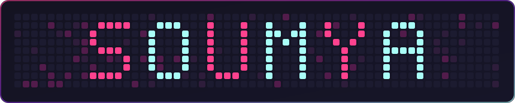

<!-- ======================================================== -->
<!-- 🚀 HEADER — ANIMATED CYBER RADICAL NAME GRID               -->
<!-- ======================================================== -->

  

<!-- ======================================================== -->
<!-- ⚡ DYNAMIC TYPING SUBTITLE                                -->
<!-- ======================================================== -->

  

<!-- ======================================================== -->
<!-- 🌐 SOCIAL CONNECT BUTTONS                                 -->
<!-- ======================================================== -->

  &nbsp;&nbsp;
  &nbsp;&nbsp;
  &nbsp;&nbsp;
  

<!-- ======================================================== -->
<!-- 👁️ PROFILE VIEWS                                         -->
<!-- ======================================================== -->

  

 

<!-- ======================================================== -->
<!-- 🧑‍💻 ABOUT ME & TOP LANGUAGES                              -->
<!-- ======================================================== -->
###  About Me

<table>
  <tr>
    <td width="58%" valign="middle" align="center">
      
    </td>
    <td width="42%" valign="middle" align="center">
      
    </td>
  </tr>
</table>

 

<!-- ======================================================== -->
<!-- 📊 STATS & STREAK (RADICAL THEME)                        -->
<!-- ======================================================== -->
### 📊 Activity & Performance

  
  &nbsp;&nbsp;
  

 

<!-- ======================================================== -->
<!-- 🛠️ TECH STACK                                            -->
<!-- ======================================================== -->
### 🛠️ Core Technologies & Tools

  

 

<!-- ======================================================== -->
<!-- 📦 FEATURED PROJECTS (RADICAL THEME)                     -->
<!-- ======================================================== -->
### 📦 Featured Projects

<table>
  <tr>
    <td width="50%" valign="top">
      
    </td>
    <td width="50%" valign="top">
      
    </td>
  </tr>
  <tr>
    <td width="50%" valign="top">
      
    </td>
    <td width="50%" valign="top">
      
    </td>
  </tr>
</table>

 

<!-- ======================================================== -->
<!-- 🐍 CONTRIBUTION GRAPH SNAKE                              -->
<!-- ======================================================== -->
### 🐍 Contribution Activity

  

<!-- ======================================================== -->
<!-- 💫 FOOTER                                                -->
<!-- ======================================================== -->

  ⚡ Designed with passion &amp; code by <a href="https://github.com/soumyaranjanmohanta123"><b>Soumya Ranjan Mohanta</b></a> • Always building, always learning.

