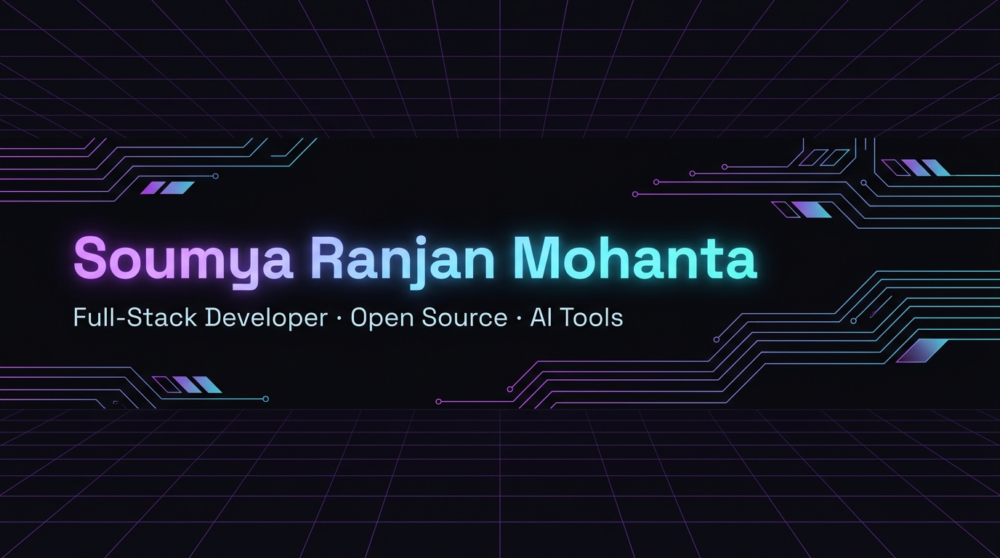



  

---

### Hi, I am Soumya 👋

Full-Stack Developer based in **Bhubaneswar, India**. I build scalable web apps, open-source tools, and LLM-powered products.

- 🔭 Working on AI tooling & RAG pipelines
- 🌱 Learning Rust
- 💬 Ask me about React, TypeScript, Node.js, Python
- 🌐 [soumya.dev](https://soumya.dev)

---

### Stats

---

### Stack

---

### Pinned

| Repo | Description | Stars |
|------|-------------|-------|
| [nexus-ai-toolkit](https://github.com/soumyaranjanmohanta123/nexus-ai-toolkit) | Production-ready LLM toolkit with RAG & observability | ⭐ 847 |
| [react-aurora-ui](https://github.com/soumyaranjanmohanta123/react-aurora-ui) | Glassmorphism React component library, 50+ components | ⭐ 1.2k |
| [devflow-cli](https://github.com/soumyaranjanmohanta123/devflow-cli) | Terminal dev workflow tool built in Rust | ⭐ 563 |
| [cloud-pulse-monitor](https://github.com/soumyaranjanmohanta123/cloud-pulse-monitor) | Real-time infra dashboard for AWS / GCP / Azure | ⭐ 721 |

---

### Connect

&nbsp;
&nbsp;
&nbsp;

 

